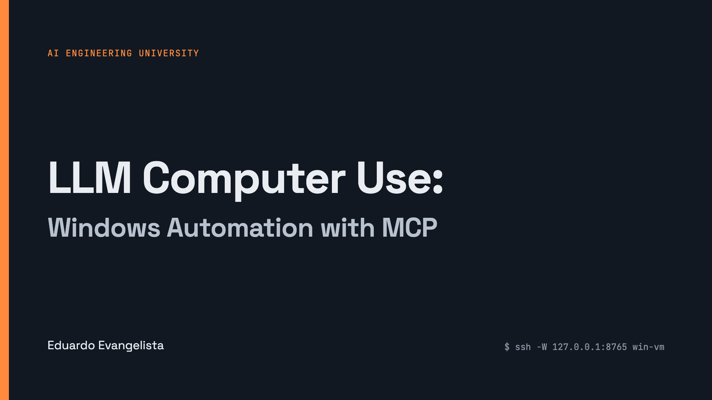
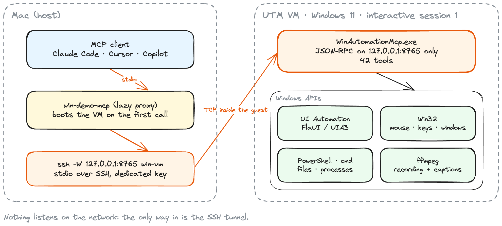
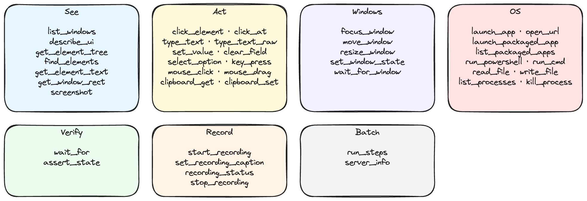
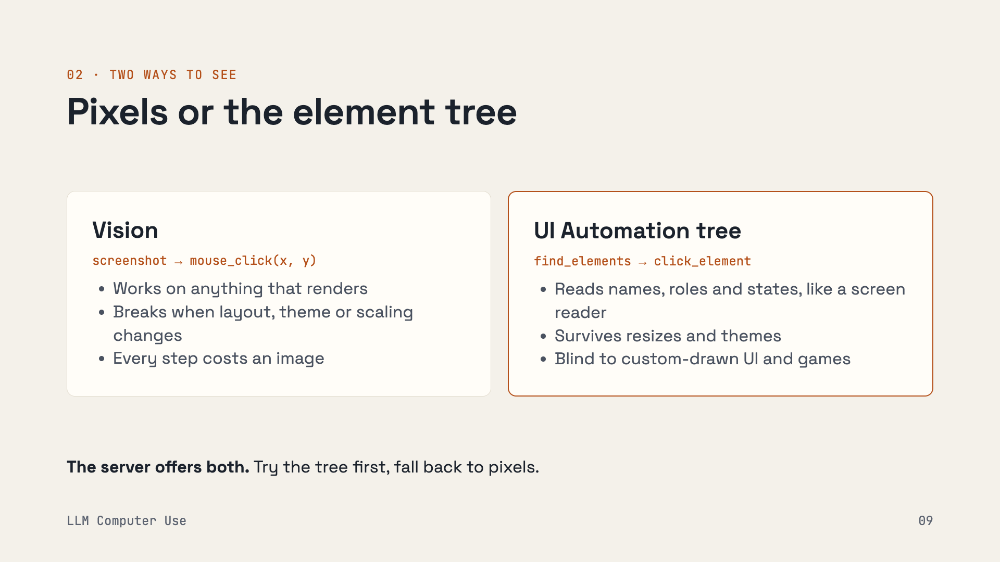
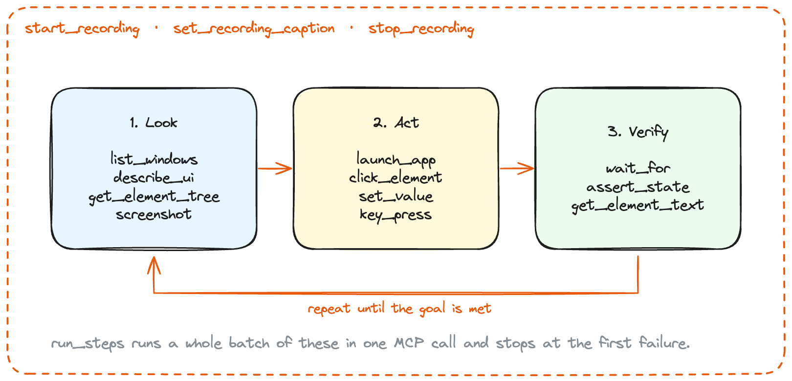
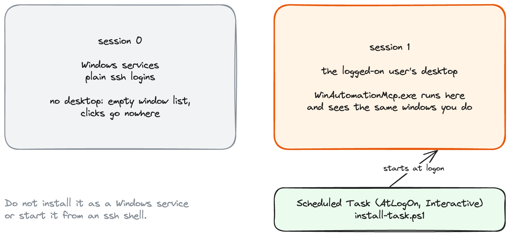
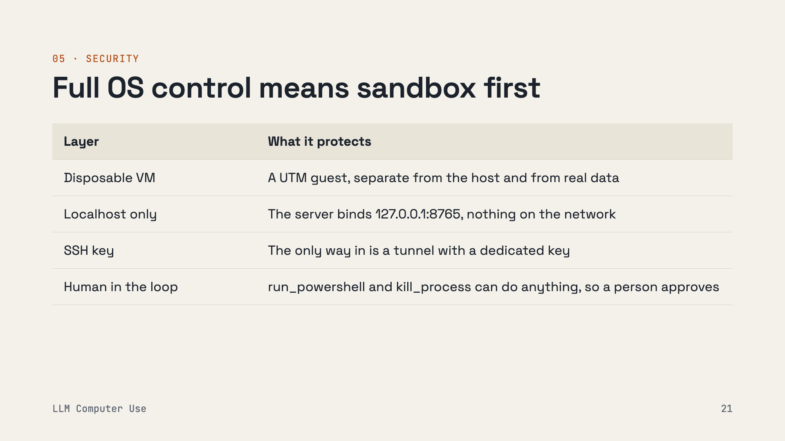
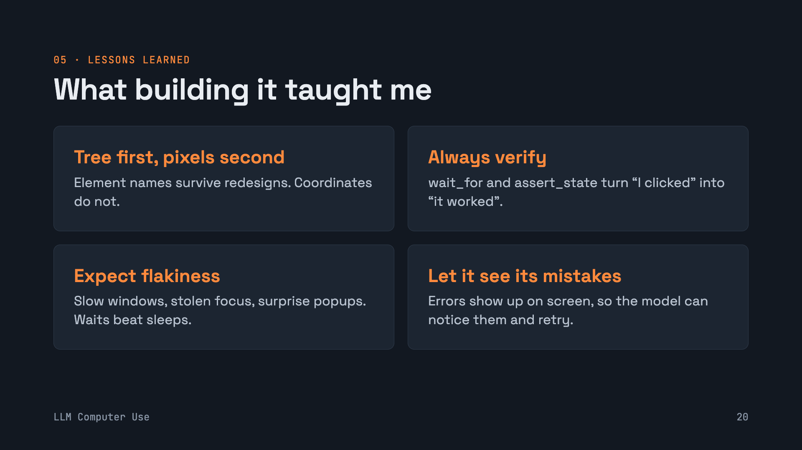

# win-automation-mcp

An MCP server that lets any LLM client (Claude Code, Cursor, Copilot, a local model) drive a Windows desktop: read the UI Automation tree, click, type, manage windows, run PowerShell, and record the screen with captions as evidence.

[](#install-with-your-agent)

## Install with your agent

Copy this prompt into your coding agent (Claude Code, Cursor, Copilot...) on the machine where you run it. The agent sets everything up and tells you when it is done.

```text
Install the win-automation-mcp MCP server for me and connect it to this agent.
Setup: I run you on this machine, and a Windows on ARM machine (usually a VM) is reachable over SSH.
The server runs inside Windows on 127.0.0.1:8765 and you reach it through `ssh -W`.

1. Find the SSH host of the Windows machine: look in ~/.ssh/config, otherwise ask me.
   Check `ssh -o BatchMode=yes <host> "echo %PROCESSOR_ARCHITECTURE%"` prints ARM64.
   If SSH fails, stop and tell me to enable OpenSSH Server in Windows and add my key.
   If it prints AMD64, stop: the prebuilt release is ARM64 only.
2. Check `ssh <host> "dotnet --list-runtimes"` lists Microsoft.WindowsDesktop.App 8.x.
   If not, ask me before installing it with
   `ssh <host> "winget install --id Microsoft.DotNet.DesktopRuntime.8 -e --accept-package-agreements --accept-source-agreements"`.
3. Download the release here:
   `gh release download v0.4.0 -R Eduaugust/win-automation-mcp -p "WinAutomationMcp-0.4.0-win-arm64.zip"`
   and check its SHA-256 is 96f521058ebe17d84110225d1ec1ae7aa1a42d95c4338f4c2ddeb73e4fc42025.
4. Copy and unzip it into the Windows user profile:
   `scp WinAutomationMcp-0.4.0-win-arm64.zip <host>:WinAutomationMcp.zip`
   `ssh <host> "powershell -NoProfile -Command Expand-Archive -Force WinAutomationMcp.zip $env:USERPROFILE"`
5. Register the logon task (it runs the server in the interactive desktop session, never as a service):
   `ssh <host> "powershell -NoProfile -ExecutionPolicy Bypass -File WinAutomationMcp\install-task.ps1 -Port 8765 -StartNow"`
   Check `ssh <host> "netstat -an | findstr 127.0.0.1:8765"` shows LISTENING.
   If not, I am probably not logged on to the Windows desktop: ask me to log on, then check again.
6. Add the MCP server to this agent with the command `ssh -W 127.0.0.1:8765 <host>`
   (Claude Code: `claude mcp add windows-automation -- ssh -W 127.0.0.1:8765 <host>`).
   Tell me if I need to restart or reconnect you.
7. Call the `server_info` tool and confirm session_id is not 0 and ffmpeg is found.
   Then show me the result and one `list_windows` call.
```

Prefer to do it by hand? See [Install](#install-in-the-windows-vm) and [Connect from the host](#connect-from-the-host).



It is a single .NET 8 executable (C#, FlaUI/UIA3) that runs inside a Windows VM, listens on `127.0.0.1:8765` only, and is reached from the host through an SSH tunnel. Nothing listens on the network.

## Architecture



The MCP client starts `ssh -W 127.0.0.1:8765 win-vm` as its "server process", so MCP messages travel over stdin/stdout through SSH straight into the server. No custom networking or auth layer: SSH does it.

`client/` holds the host-side helpers:

| File | What it does |
|---|---|
| `win-mcp-proxy.py` | stdio bridge that survives tunnel drops: fails in-flight requests fast, reconnects with backoff and replays `initialize`. |
| `win-demo-mcp` | lazy proxy: answers `initialize`/`tools/list` from a cache so the VM stays off until a tool is actually called. |
| `win-demo-vm` | boots or resumes the UTM VM, waits for the server, opens the tunnel, suspends the VM after it has been idle. |

## Tools

42 tools in 0.4.0 (`server_info` lists them all):



Two ways to see the screen, and the server offers both. Try the tree first, fall back to pixels:



## The agent loop



`run_steps` batches a whole sequence into one MCP call (from `test/t_run_steps.py`):

```json
{"window": "Calculator", "steps": [
  {"action": "launch_app", "path": "calc.exe", "window": "Calculator", "wait_ms": 30000},
  {"action": "wait_for", "automation_id": "num7Button", "condition": "exists", "timeout_ms": 15000},
  {"action": "click_element", "automation_id": "num7Button"},
  {"action": "click_element", "automation_id": "multiplyButton"},
  {"action": "click_element", "automation_id": "num6Button"},
  {"action": "click_element", "automation_id": "equalButton"},
  {"action": "assert_state", "automation_id": "CalculatorResults", "condition": "text_contains", "value": "42"},
  {"action": "screenshot", "max_width": 400}
]}
```

See [docs/release-0.4.0.md](docs/release-0.4.0.md) for `run_steps` options, element targeting, `describe_ui` and recording details.

## Run it in the interactive session



Windows services and plain ssh logins live in session 0, which has no desktop: the server starts fine and sees nothing. It has to run in the logged-on user's session, so it is started at logon by a Scheduled Task. `server_info` reports the `session_id`.

## Install (in the Windows VM)

Prebuilt: download `WinAutomationMcp-0.4.0-win-arm64.zip` from [Releases](../../releases), unzip it anywhere and register the logon task. It needs the [.NET 8 Desktop Runtime](https://dotnet.microsoft.com/download/dotnet/8.0) and bundles an ARM64 ffmpeg (BtbN GPL build), so it targets Windows on ARM (for example a UTM VM on Apple Silicon).

```powershell
cd WinAutomationMcp
.\install-task.ps1 -Port 8765 -StartNow
```

On x64, build it yourself and drop an x64 `ffmpeg.exe` into `.\tools\` (or set `WIN_MCP_FFMPEG`):

```powershell
dotnet build -c Release -nologo
.\install-task.ps1 -Port 8765 -StartNow
```

Options: `--port N` (or `WIN_MCP_PORT`), `WIN_MCP_LOG_DIR`, `WIN_MCP_FFMPEG`. `install-task.ps1 -Remove` unregisters the task.

## Connect from the host

```bash
# plain tunnel
claude mcp add windows-automation -- ssh -W 127.0.0.1:8765 win-vm
# or the reconnecting proxy
claude mcp add windows-automation -- python3 client/win-mcp-proxy.py --host win-vm --port 8765
```

Any MCP client works the same way: the command is just the tunnel.

## Security



`run_powershell`, `run_cmd`, `write_file` and `kill_process` are arbitrary code execution as the logged-on user. Screenshots, recordings, `get_element_text` and `clipboard_get` show whatever is on screen, including revealed passwords. Run it only in a disposable VM, never expose the port, and keep recordings out of git. The server log records argument names only, never values.

## Lessons learned



## Layout

| Path | Contents |
|---|---|
| `Program.cs` | JSON-RPC server, logging, tool dispatch |
| `Tools.cs` | tool list and JSON schemas |
| `Uia.cs`, `UiaExtra.cs` | UI Automation tools (targeting, `describe_ui`, `set_value`, window waits) |
| `Steps.cs` | `run_steps` |
| `Capture.cs`, `Recorder.cs` | screenshots, ffmpeg recording and captions |
| `SystemTools.cs`, `Win32.cs`, `Infra.cs` | commands, files, processes, clipboard, P/Invoke, helpers |
| `test/` | Python MCP test client and a small WinForms test app |
| `docs/` | release notes, diagrams and slides behind the images above |

## Regenerating the images

The diagrams are Excalidraw scenes (`docs/diagrams/*.excalidraw`, open them at excalidraw.com to edit) generated from `docs/diagrams/scenes.mjs`. The slides come from the talk deck (`docs/slides/*.html`). Both render with Playwright and a local Chrome:

```bash
PLAYWRIGHT=/path/to/node_modules/playwright node docs/diagrams/render.mjs
PLAYWRIGHT=/path/to/node_modules/playwright node docs/slides/render.mjs
```
